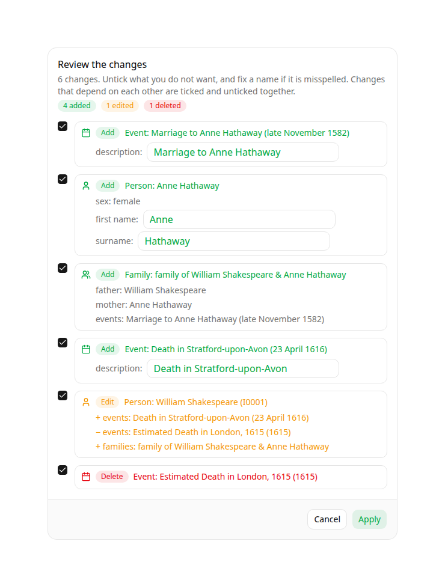

# gramps-mcp

An unofficial [MCP](https://modelcontextprotocol.io/) server that exposes one
or more [Gramps Web API](https://github.com/gramps-project/gramps-web-api)
trees to LLM assistants (Claude, etc.), against your own genealogy data.

Since several assistants (e.g. Claude, Antigravity) support voice input, this
works particularly well hands-free and conversationally: you can ask an
open-ended research question — *"give me a breakdown of the social classes of
the people in this tree"* — or edit the tree live by voice, the same way you'd
dictate a change to an assistant in any other MCP-backed app.

It works by pointing [FastMCP](https://gofastmcp.com/)'s
`FastMCP.from_openapi()` at your Gramps Web API instance's `openapi.json` and
auto-generating the read tools from the REST endpoints, giving one set of tools for
all the configured trees behind optional Google OAuth and a per-tree membership
check. Writing goes through a single tool, `apply_changes`, which shows every
change to the user and writes only once they confirm.

## Safe, interactive writes with MCP Apps

Writing to a genealogy database requires strict care: invalid references or wrong schemas can corrupt a tree. `gramps-mcp` channels all modifications through a single entry point, `apply_changes`. When connected to an MCP client supporting **MCP Apps (Prefab UI)** (e.g. Visual Studio Code with Copilot), it turns planned changes into a live, interactive review card:

<p align="center">
  
</p>
<p align="center">
  <a href="https://jerive.github.io/gramps-mcp/assets/shakespeare-card.html"><strong>🔗 Try the live interactive card</strong></a> &bull;
  <a href="https://jerive.github.io/gramps-mcp/assets/demo.mp4"><strong>🎬 Watch the end-to-end demo video</strong></a>
</p>

- **Visual status badges**: Additions in green, edits in orange, and deletions in red.
- **Automatic dependency cascades**: Unticking a change automatically unticks everything that depends on it (e.g. unticking a person unticks their marriage family).
- **Inline text editing**: Fix names, descriptions, or surnames directly in the card before applying.
- **Model isolation**: Clicking **Apply** calls `confirm_changes` with a single-use token. This tool is hidden from the model (`visibility: ["app"]`), guaranteeing the AI cannot self-approve.
- **Atomic rollback**: If any change fails, all preceding changes in the transaction are rolled back atomically.

In clients without MCP Apps support, it seamlessly falls back to standard MCP text elicitation.

## Status and scope

This is a community project, not affiliated with or endorsed by the Gramps
project. See
[gramps-web-api#1003](https://github.com/gramps-project/gramps-web-api/issues/1003)
for the maintainer's position: Gramps Web API intentionally exposes an open,
scriptable REST API, but the project won't officially endorse an MCP layer on
top of it, in part because **the Gramps database model is not very fault
tolerant** — a bad write (dangling reference, wrong schema, etc.) can corrupt
a tree, and that risk is higher when requests are agent-generated rather than
hand-written. Point this at a tree you're prepared to back up and, if
necessary, recover from an LLM's mistakes. It's aimed at users comfortable
with that trade-off, not a general recommendation.

[gramps-web-api#943](https://github.com/gramps-project/gramps-web-api/issues/943)
and its follow-ups
([#944](https://github.com/gramps-project/gramps-web-api/pull/944),
[#971](https://github.com/gramps-project/gramps-web-api/pull/971)) improved
`openapi.json` specifically to make this kind of generation work cleanly —
every operation now has a unique `operationId` and a specific summary, and
mutation endpoints document their request body.

## Documentation

The full documentation is at **<https://jerive.github.io/gramps-mcp/>**:

- [Tutorial](https://jerive.github.io/gramps-mcp/tutorial/): run everything
  locally against Gramps' example tree, in about 15 minutes.
- [How-to guides](https://jerive.github.io/gramps-mcp/how-to/service-account/):
  service account, Google sign-in, Docker Compose, running without Docker,
  connecting an MCP client.
- [Reference](https://jerive.github.io/gramps-mcp/reference/configuration/):
  every environment variable, and the generated tools.
- [Explanation](https://jerive.github.io/gramps-mcp/explanation/how-it-works/):
  how it works, and the security and risk model.

## Quick start

You need a running [Gramps Web API](https://github.com/gramps-project/gramps-web-api)
instance with a tree, a Gramps Web user for that tree, and Python 3.12+.

```sh
# Tracks master. For reproducibility, pin a release by appending @<tag>, for
# example @v0.5.1; the tags are listed on the Releases page.
pip install "gramps-mcp @ git+https://github.com/jerive/gramps-mcp"
export GRAMPS_BACKEND_URL=http://localhost:5000
export GRAMPS_MCP_TREES=MyTree
export GRAMPS_MCP_TREE_MYTREE_USERNAME=myuser
export GRAMPS_MCP_TREE_MYTREE_PASSWORD=mypassword
export MCP_HOST=127.0.0.1   # without auth, only listen on localhost
gramps-mcp
```

Then point your MCP client at `http://localhost:8000/mcp`. Prefer a **Member**
(read-only) Gramps user unless you want the agent to edit the tree.

## License

MIT.
