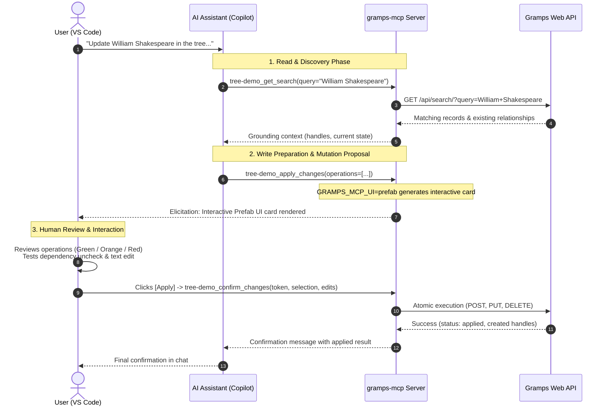

# How it works

## One OpenAPI document, one read tool per endpoint

Gramps Web API publishes an OpenAPI document. `gramps-mcp` hands it to
[FastMCP](https://gofastmcp.com/)'s `FastMCP.from_openapi()`, which produces an
MCP tool for every read operation. Nothing in this project describes a Gramps
read endpoint by hand. That is the whole design bet: the server stays a thin shell,
and the tool set tracks Gramps Web API for free.

The bet only works because Gramps Web API gives every operation a unique
`operationId`, a specific summary and a documented request body. Those
improvements (see
[#943](https://github.com/gramps-project/gramps-web-api/issues/943),
[#944](https://github.com/gramps-project/gramps-web-api/pull/944) and
[#971](https://github.com/gramps-project/gramps-web-api/pull/971)) are what
make the generated tool names and descriptions usable by a language model.

## One sub-server per tree

A single Gramps Web API instance can host several trees, and each tree has its
own users. The server builds one generated sub-server **per tree**, logged in
as that tree's service account, and mounts each under the namespace
`tree-<name>`. A client sees all of them from a single MCP endpoint, and a
tool call for `tree-a` can never be answered with `tree-b`'s credentials.

## What the server adds on top of the generation

- **Pruning.** A handful of route prefixes are excluded, either because they
  would let an agent manage users or tokens, or because they are server
  configuration. See [Tools and resources](../reference/tools.md#excluded-routes).
- **Looser schemas.** Output schemas are dropped so a slightly unusual Gramps
  response doesn't make a tool call fail validation.
- **One write tool.** Generated write endpoints would let a model send a raw
  `PUT` body, which is how dangling references get written. They are all
  excluded. `apply_changes` takes small typed operations, merges partial
  updates into the current object itself, shows the user every change and
  writes only after confirmation, and undoes earlier changes if a later one
  fails.
- **Token upkeep.** Logins are retried at startup, since Gramps Web may still be
  booting, and tokens are refreshed in the background.
- **A query-language guide.** The `gramps://goql-spec` resource gives an agent
  what it needs to write GOQL queries, without stuffing it into every tool
  description.

## Safe write flow with elicitation and MCP Apps

Modifying a genealogy database presents unique risks because relationships span across several tables (e.g., people, families, events, places). A direct REST `PUT` or `POST` by an LLM could leave dangling references or corrupt family links.

To protect data integrity, `gramps-mcp` funnels all writes through `apply_changes`. When connected to an MCP client supporting **MCP Apps (Prefab UI)** (such as Visual Studio Code with Copilot), it executes the following flow:

1. **Discovery**: The model queries the tree to ground itself on real handles and current data.
2. **Proposal**: The model drafts the atomic operations (`create`, `update`, `delete`).
3. **Interactive Elicitation**: Instead of writing immediately, `gramps-mcp` yields an interactive card with dependency closure and inline editing.
4. **App-Only Confirmation**: The user clicks **Apply**, which calls `confirm_changes`. Because `confirm_changes` is marked with `visibility: ["app"]`, the host keeps it hidden from the LLM, guaranteeing the model cannot self-confirm.
5. **Atomic Rollback**: If an operation fails, previous operations in the set are rolled back atomically via Gramps Web API transactions.

## Authentication, in two layers

There are two unrelated identities in play:

1. **Who may talk to the MCP server.** Optional Google sign-in, enabled by
   setting `GOOGLE_CLIENT_ID` and `GOOGLE_CLIENT_SECRET`. MCP clients register
   themselves dynamically and obtain tokens; Redis stores them so a restart
   doesn't make everyone sign in again.
2. **What the server may do in Gramps.** The service-account user of each tree.
   Its role is the hard ceiling on every action an agent can take.

Between the two sits the **per-tree membership check**: a signed-in Google user
may use a tree only if their email belongs to a Gramps Web user of that tree,
or to `GRAMPS_MCP_ADMIN_EMAILS`. The membership list comes from
`GET /api/users/`, cached for `GRAMPS_MCP_GOOGLE_TOKEN_CACHE_TTL` seconds. That
call needs an Owner (or admin) account, which is why the choice of role
involves a real trade-off. See
[Security and risk model](security-model.md).

When Google sign-in is disabled, none of the second layer's checks run.
