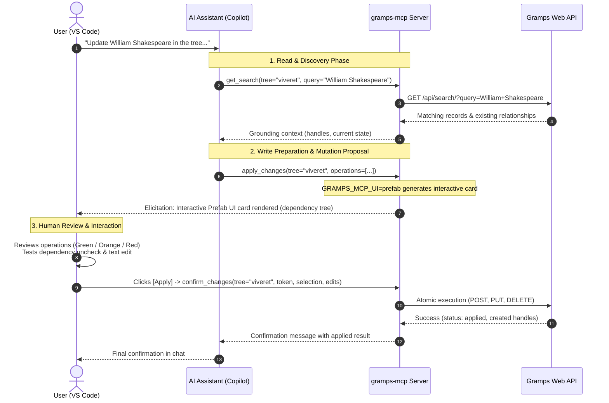

# How it works

## Eight tools, shared across all trees

Rather than exposing dozens of raw REST endpoints that clutter the model's context window, `gramps-mcp` exposes only **eight focused tools**:

- **Seven read operations**:
  - `list_objects`: Page objects of any of the 10 Gramps types (`people`, `families`, `events`, etc.).
  - `get_object`: Fetch a single object by handle.
  - `query_objects`: Query objects matching a [GOQL](../reference/goql.md) `where_expr`.
  - `get_search`: Full-text search across all object types.
  - `get_relation` / `get_relations`: Calculate relationship paths between people.
  - `get_person_timeline` / `get_family_timeline`: Chronological events for a person or family.
  - `list_trees`: Available trees for the authenticated user.
- **One write operation**:
  - `apply_changes`: The single atomic mutation entry point (`create`, `update`, `delete`), backed by human-in-the-loop confirmation.

All trees configured in `GRAMPS_MCP_TREES` share these same tools. Each tool takes a `tree` parameter (optional when only one tree is configured). The server keeps a dedicated HTTP client per tree logged in as that tree's service account, guaranteeing that requests for tree A can never use tree B's credentials.

## What the server adds on top of the generation

- **Route pruning.** Administration routes (users, tokens, server config) are never exposed to the agent.
- **Looser schemas.** Read output schemas are dropped so minor upstream variation never breaks validation.
- **Safe write flow.** Direct `PUT`/`POST` endpoints are excluded. `apply_changes` merges changes, builds a readable summary, asks for confirmation, and rolls back atomically on failure.
- **Token upkeep.** Automatic background login and token refresh for each tree's service account.
- **GOQL spec resource.** The `gramps://goql-spec` resource gives the agent query documentation on demand without bloating tool descriptions.

## Safe write flow with elicitation and MCP Apps

Modifying a genealogy database presents unique risks because relationships span across several tables (e.g. people, families, events, places). A direct REST `PUT` or `POST` by an LLM could leave dangling references or corrupt family links.

To protect data integrity, `gramps-mcp` funnels all writes through `apply_changes`. When connected to an MCP client supporting **MCP Apps (Prefab UI)** (such as Visual Studio Code with Copilot), it executes the following flow:

1. **Discovery**: The model queries the tree to ground itself on real handles and current data.
2. **Proposal**: The model drafts the atomic operations (`create`, `update`, `delete`).
3. **Interactive Elicitation**: Instead of writing immediately, `gramps-mcp` yields an interactive card with dependency closure and inline editing.
4. **Human Confirmation**: The user reviews, edits if needed, and clicks **Apply** to execute the mutations atomically.
5. **Atomic Rollback**: If an operation fails, previous operations in the set are rolled back atomically via Gramps Web API transactions.

## Authentication, in two layers

There are two unrelated identities in play:

1. **Who may talk to the MCP server.** Optional Google sign-in, enabled by setting `GOOGLE_CLIENT_ID` and `GOOGLE_CLIENT_SECRET`. MCP clients register dynamically and obtain tokens; Redis stores them so a restart does not invalidate sessions.
2. **What the server may do in Gramps.** The service-account user of each tree. Its role is the hard ceiling on every action an agent can take.

Between the two sits the **per-tree membership check**: a signed-in Google user may use a tree only if their email belongs to a Gramps Web user of that tree, or to `GRAMPS_MCP_ADMIN_EMAILS`. It is checked on every call for the named `tree`. The membership list comes from `GET /api/users/`, cached for `GRAMPS_MCP_GOOGLE_TOKEN_CACHE_TTL` seconds.

When Google sign-in is disabled, only the service-account layer applies.
