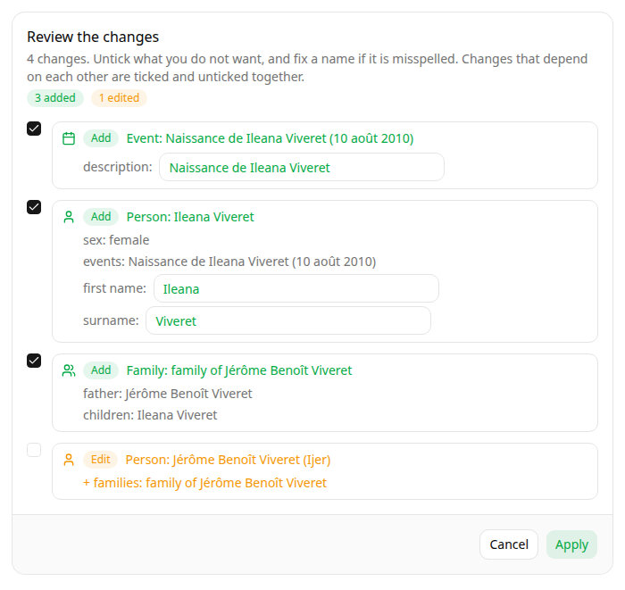
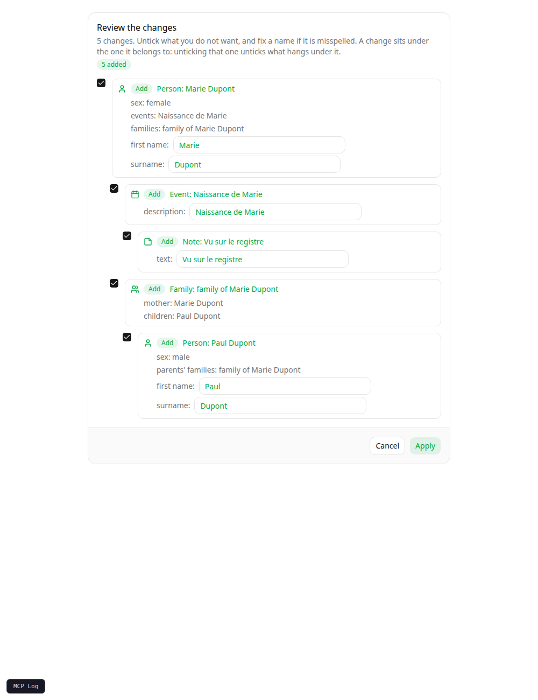

# Tools and resources

## Read tools

For every tree in `GRAMPS_MCP_TREES`, the server reads that Gramps Web API
instance's `openapi.json` at startup and generates the read tools from it.
Tools are mounted under a per-tree namespace, `tree-<name>_<tool>`. Eight read
tools are exposed:

| Tool | Reads |
|---|---|
| `list_objects` | A page of objects of one type, with filters, sorting and the `profile`/`extend` options. |
| `get_object` | One object of any type, from its handle. |
| `query_objects` | Objects of one type matched by a [GOQL](goql.md) `where_expr`, with `select`, `order_by`, `limit` and `count`. |
| `get_search` | Full-text search across all types. |
| `get_relation`, `get_relations` | How two people are related, and every way they are. |
| `get_person_timeline`, `get_family_timeline` | The events around a person or a family. |

`list_objects`, `get_object` and `query_objects` take an `object_type`
(`people`, `families`, `events`, `places`, `citations`, `sources`,
`repositories`, `notes`, `tags`, `media`). Gramps Web API defines the same
operation for each type, so the server merges them instead of listing ten
copies of each: the three tools cost about as much context as one set. Their
parameters, descriptions and types are those of the backend's spec. If a type's
operation ever differs from the others in a future Gramps version, that type
keeps its own tools.

Reports, exports, imports, media files and thumbnails, DNA, tree administration
and the like are not exposed. `GRAMPS_MCP_READ_TOOLS=all` exposes every read
route of the backend as its own tool (about 90 per tree).

### Gramps Web API version

The tools follow the Gramps Web API you run: nothing about its schema is copied
into this package. At startup the server checks the version in the backend's
spec. It refuses to start below 3.23 (when GOQL's `MatchesQuery` arrived) and
logs a warning above the newest version it is tested with, so a newer backend is
used rather than refused. The test suite runs against the minimum and the
latest published version.

No generated tool writes. Every other `POST`, `PUT`, `PATCH` and `DELETE`
(including `merge`, the bulk `objects` endpoints, `transactions` and `chat`) is
excluded, so a new write endpoint is never exposed by accident.

## The write tool

`tree-<name>_apply_changes` is the only way to change a tree. It takes one set
of 1 to 20 operations, in order:

| `op` | Fields | Meaning |
|---|---|---|
| `create` | `type`, `object` | Add the full object. `_class` may be left out; if given it must match `type`. |
| `update` | `type`, `handle`, `changes` | Merge `changes`, a nested object holding only the changed fields, into the current object. A list replaces the whole list. |
| `delete` | `type`, `handle` | Delete the object. |

`type` is one of `people`, `families`, `events`, `places`, `citations`,
`sources`, `repositories`, `media`, `notes`, `tags`. Unknown keys are refused,
as are `handle`, `_class` and the read-only fields (`backlinks`, `extended`,
`profile`) in `changes`, a handle longer than 50 characters, and two operations
on the same object.

The server reads the current objects, builds a readable summary of every
change, and asks the user once to confirm, through MCP elicitation. The summary
names things instead of showing handles and raw fields: people, families and
events are named (through the API's `profile=self`, or from the objects created
in the same set), field names become words and a date changes as one line:

```
Apply these 4 change(s) to the tree?

1. Add event: Birth, 10 août 2010
2. Add person: Ileana Viveret
    - sex: female
    - events: Birth, 10 août 2010
3. Add family: family of Jérôme Benoît Viveret
    - father: Jérôme Benoît Viveret
    - children: Ileana Viveret
4. Edit person: Jérôme Benoît Viveret (I0001)
    - families: add family of Jérôme Benoît Viveret
```

The text is also valid Markdown, so clients that render it show a list with the
details nested under each change.

A reference that is not in the tree shows as "a person that is not in the tree"
rather than a handle. Nothing is
written if the user declines or cancels, or if the client cannot ask: a client
without elicitation support gets `not_applied` and the tree is untouched.

Both ways of asking are supported: the question sent in the middle of the call
by clients on protocol versions before `2026-07-28`, and the "input required"
result that the call returns, and the client answers by calling again, from
`2026-07-28` on. In the second flow the server sends a digest of the summary
with its question, and counts the answer only if the summary it rebuilds on the
retry has the same digest. If an object changed while the user was deciding, the
user is asked again about what would now be written; after three tries, nothing
is written.

If the answer is not a confirmation, the result says what the client sent:
`The user declined.`, `The user dismissed the confirmation (cancel).`, or
`The client did not confirm: accept without confirming (content: ...)` when a
client answered "accept" without the `confirm` field set to `true`. The server
logs one line per decision at `INFO`, with the client name and version and the
protocol version, for example `apply_changes confirmation from Copilot 1.2
(protocol 2026-07-28): accept`.

By default a client that cannot ask for confirmation writes nothing. Set
[`GRAMPS_MCP_CONFIRMATION=when-supported`](configuration.md#confirmation-of-writes)
to apply the changes directly for such clients instead; clients that can ask are
still asked.

The tool also carries `_meta["anthropic/requiresUserInteraction"] = true`, which
makes Claude Code show its own approval prompt on every call, whatever the
permission mode. That prompt shows the raw arguments; the readable summary
comes with the confirmation.

Changes are written in order. If one fails, the earlier ones are undone in a
single call to Gramps' transactions endpoint, which applies the undo all or
nothing and refuses it if an object has changed since.

The result has a `status`:

| `status` | Meaning |
|---|---|
| `applied` | Everything was written. Created objects come back with their handle. |
| `declined` | The user did not confirm. |
| `not_applied` | Nothing was written: the client cannot confirm (in `required` mode), or the first change failed. |
| `invalid` | The changes could not be planned, for example an unknown handle. |
| `rolled_back` | A change failed and the earlier ones were undone. |
| `partly_applied` | A change failed and the earlier ones could not be undone; the message says why. |

The preview shows the objects you name, not the ones Gramps updates as a
consequence (editing a family also rewrites its members, deleting an event
rewrites everyone who refers to it). The role of the service account still
bounds what can be written: see
[Create a Gramps Web service account](../how-to/service-account.md).

### Excluded routes

These prefixes are never turned into tools:

| Prefix | Why |
|---|---|
| `/api/filters/` | Saved (custom) filters are better kept out of an agent's hands. |
| `/api/token/` | The server already handles authentication and token refresh. |
| `/api/users/` | The server uses it itself for the membership check; user management is not for an agent. |
| `/api/facts/`, `/api/facts` | Not useful to an agent. |
| `/api/config`, `/api/oidc/config` | Server configuration is not useful to an agent. |

The list lives in `EXCLUDED_ROUTE_PREFIXES` in `src/gramps_mcp/trees.py`; the read-only rule is `map_route` in the same file.

### Request handling

- **Output schemas of the read tools are dropped**, since Gramps' response schemas are too loose
  for strict validation to help.
- **Authentication** to Gramps Web is automatic. The server logs in once per
  tree and refreshes the token in the background.

## Resources

| URI | Content |
|---|---|
| `gramps://goql-spec` | A guide to the Gramps Object Query Language ([the same text is here](goql.md)), so an agent can write a valid `where_expr` for `query_objects` before calling them. |

## Interactive card (experimental)

With `GRAMPS_MCP_UI=prefab`, `apply_changes` shows its changes as a card in
clients that render MCP Apps, instead of asking for a confirmation:



- **Tick or untick** each change. The changes are shown as a tree: a change
  hangs under the one it belongs to. A birth hangs under its person and a note
  under the birth, a family under its mother and the child under the family.
  Unticking a change unticks everything under it, and ticking a change ticks
  what it hangs under. Ticking a prerequisite again does not tick back what hung
  under it.

  What belongs to what is read from the lists in each object: a person's or
  family's `event_ref_list`, and any `note_list`, `citation_list` and
  `media_list`, belong to the object that lists them. A family needs the parents
  it names and a child needs its family. The lists that only record a link
  (`family_list`, `child_ref_list`, `tag_list`) do not make anything depend on
  anything. When a change is left out, it is also taken out of the lists of the
  changes that are applied: unticking the child creates the family without that
  child, unticking the birth creates the person without it, and an edit whose
  only change was such a link is not sent.



- **Fix a name** before applying: a first name, surname, event description,
  place name, note text, title. Only these text fields of a created object, or
  of an edited one that the change touches, can be edited, up to 500
  characters. Dates, handles and references cannot.
- **Apply** calls `confirm_changes`, a tool the host keeps away from the model
  (`visibility: ["app"]`). The server rebuilds the changes, refuses them if an
  object changed since the card was shown, checks the selection is consistent
  and the edits are allowed, writes what is selected, and the outcome is sent to
  the conversation as a message. **Cancel** writes nothing.
- A card can be applied once, within 30 minutes. They are kept in memory, so a
  restart expires them: ask for the changes again.

A client that does not advertise MCP Apps gets the confirmation described above
(elicitation), as if the card did not exist. `GRAMPS_MCP_UI=prefab-always` shows
the card to every client; one that cannot render it then writes nothing.

Limits to know. The guarantee that the model cannot confirm for the user rests
on the host keeping `confirm_changes` out of the model's tool list, as the MCP
Apps specification asks; check it in your client. The card does not set Claude
Code's `requiresUserInteraction` mark, and `apply_changes` has no output schema
in this mode. The labels that name an object do not follow a name you are
editing until you apply.

## Endpoint

The server speaks MCP's streamable HTTP transport at `/mcp`. With Google
sign-in enabled it also serves the OAuth metadata and authorization endpoints
that MCP clients discover automatically.
